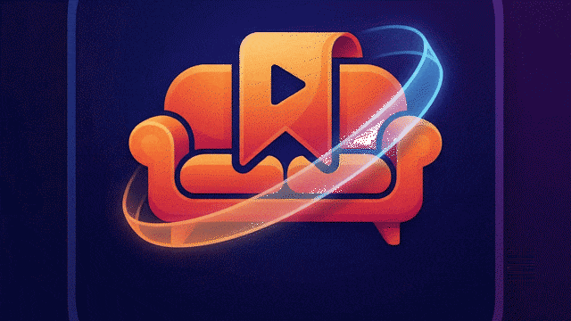

<p align="center">
  
</p>

<h1 align="center">Couchmark</h1>

<p align="center">
  <strong>The ultimate living room experience for your local media collection.</strong><br/>
  A fast, native Windows media center that remembers your exact watch progress — down to the second.
</p>

<p align="center">
  
  
  
  
  
</p>

---

## 🛋️ Why Couchmark?

Streaming platforms like Netflix, Prime, and Apple TV have conditioned us to expect smooth living-room experiences: resume playback from the exact second, auto-play the next episode, and skip intro sequences in one click. 

Traditional local media players (like VLC or MPC) don't track your library watch state cleanly, while self-hosted media servers (like Plex or Jellyfin) require complex server-client setups, transcoding overhead, and account registrations.

**Couchmark gives you the best of both worlds**: a standalone, zero-bloat Windows desktop media center with a modern streaming-service UI that plays your local files directly with hardware-accelerated LibVLC.

---

## ✨ Features

### 🎬 Streaming-Style Living Room Interface
- **Modern Fluent UI** built with Windows 11 aesthetics and [WPF-UI](https://github.com/lepoco/wpfui).
- **Home Dashboard**: Continue Watching row with watch percentage indicators, Recently Added Shows, and Recently Added Movies.
- **Custom Visual Palettes**: Choose between **Midnight** (cool deep navy), **Vanta Black** (pure OLED dark), **Nude** (warm cream, gentle on eyes), and **White** (clean light mode).

### ⏩ Smart Skip Intro & Skip Credits
- **Configurable Timestamp Windows**: Set intro and credits ranges so the floating **"Skip Intro"** and **"Skip Credits"** buttons appear exactly when needed.
- **Season-Wide Bulk Apply**: Set the theme song window once and apply it to an entire season in a single click.
- **Live In-Player Marker Capture**: Press <kbd>T</kbd> while watching to grab timestamps in real time with one-click **"Use Current Time"** buttons.

### ⏱️ True Watch Progress & Resume
- Automatically saves playback position to a local SQLite database every 5 seconds.
- Resume prompts pick up seamlessly where you left off.
- Automatically marks titles as **Watched** once 90% of the duration has been completed.
- Manual right-click context menu to mark individual episodes, full shows, or movies as watched/unwatched.

### 🍿 TV Show & Next Episode Auto-Play
- Full season and episode browser with episode still thumbnails, air dates, and synopsis.
- **10-Second Auto-Play Countdown**: When an episode finishes, a countdown timer prepares the next episode.
- **Cross-Season Continuation**: Automatically rolls over from the season finale to S(n+1)E01.

### 🔍 Auto-Scan & Real-Time File Watcher
- Point Couchmark to your Movie and TV folders—it categorizes and catalogs everything automatically.
- Built-in **FileSystemWatcher** detects newly downloaded seasons or deleted files in real time without restarting the app.
- Multi-pattern parsing engine supports Plex-style folders, standard season folders, and flat naming schemes.

### 🎨 Rich Metadata & Artwork
- Auto-fetches high-resolution backdrops, posters, plot overviews, and genres from **The Movie Database (TMDB)**.
- Pulls live IMDb ratings via **OMDB**.
- Built-in **"Fix Match"** modal to search or override metadata by TMDB ID or URL.

### 🎞️ Powerful Playback Engine (LibVLCSharp)
- Hardware-accelerated playback supporting virtually any video format: `.mkv`, `.mp4`, `.avi`, `.mov`, `.wmv`, `.webm`, `.ts`, and more.
- Mid-playback **Audio & Subtitle Track Switcher** for embedded multi-language MKV streams.
- Auto-loads external subtitle files (`.srt`, `.ass`, `.ssa`, `.sub`, `.vtt`) stored alongside video files.

---

## ⌨️ Keyboard & Mouse Controls

| Shortcut | Action |
|:---:|:---|
| <kbd>Space</kbd> | Play / Pause |
| <kbd>←</kbd> / <kbd>→</kbd> | Seek backward / forward 10 seconds |
| <kbd>↑</kbd> / <kbd>↓</kbd> | Adjust volume up / down (5% increments) |
| <kbd>M</kbd> | Mute / Unmute audio |
| <kbd>F</kbd> | Toggle Fullscreen |
| <kbd>S</kbd> | Trigger **Skip Intro** or **Skip Credits** when visible |
| <kbd>T</kbd> | Open / Close **Live Skip Timestamps** overlay |
| <kbd>Esc</kbd> | Exit fullscreen or stop playback |
| *Mouse Inactivity* | Controls and cursor automatically hide after 3 seconds |

---

## 📁 Recommended Folder Structure

Couchmark flexibly detects multiple folder naming patterns. For best results, organize your libraries like this:

### TV Shows
```text
TV Shows/
├── Suits/
│   ├── Suits Season 1/
│   │   ├── Suits S01E01 - Pilot.mkv
│   │   └── Suits S01E02 - Errors and Omissions.mkv
│   └── Suits Season 2/
│       └── Suits S02E01.mkv
└── Breaking Bad/
    ├── Season 01/
    │   ├── S01E01.mkv
    │   └── S01E02.mkv
```

### Movies
```text
Movies/
├── Inception (2010).mkv
├── The Dark Knight (2008)/
│   ├── The Dark Knight (2008).mkv
│   └── The Dark Knight (2008).en.srt
```

---

## 🚀 Getting Started

### Prerequisites
- **Windows 10 / 11** (x64)
- [.NET 9 Runtime](https://dotnet.microsoft.com/download/dotnet/9.0)
- Free [TMDB API Key](https://www.themoviedb.org/settings/api) *(for metadata and posters)*
- Optional free [OMDB API Key](https://www.omdbapi.com/apikey.aspx) *(for IMDb ratings)*

### Running from Pre-built Binary
1. Download the latest release from the [Releases](../../releases) section.
2. Extract the archive and launch `Couchmark.exe`.
3. Open **Settings** from the sidebar:
   - Enter your TMDB and OMDB API keys.
   - Add your local **Movie** and **TV Show** directories.
   - Choose your preferred theme and home row ordering.
4. Click **Scan Now** — your collection will populate with artwork within moments.

### Building from Source
Ensure you have the [.NET 9 SDK](https://dotnet.microsoft.com/download/dotnet/9.0) installed.

```powershell
# Clone the repository
git clone https://github.com/<your-username>/Couchmark.git
cd Couchmark

# Restore dependencies & build
dotnet build src/Couchmark/Couchmark.csproj

# Run tests
dotnet test src/Couchmark.Tests/Couchmark.Tests.csproj

# Launch the app
dotnet run --project src/Couchmark/Couchmark.csproj
```

---

## 🧱 Architecture & Tech Stack

- **UI Framework:** WPF on .NET 9 with [WPF-UI](https://github.com/lepoco/wpfui) (Fluent Design)
- **MVVM Pattern:** `CommunityToolkit.Mvvm` with source generators
- **Playback Engine:** `LibVLCSharp.WPF` and native `VideoLAN.LibVLC.Windows`
- **Database & ORM:** SQLite with `Microsoft.EntityFrameworkCore.Sqlite`
- **Metadata APIs:** `TMDbLib` for TMDB and `HttpClient` for OMDB
- **Dependency Injection:** `Microsoft.Extensions.Hosting` & `Microsoft.Extensions.DependencyInjection`
- **Logging:** `Serilog` with rolling file sinks stored in `%AppData%\Couchmark\Logs`

---

## 🤝 Contributing

Contributions, bug reports, and suggestions are welcome!
1. Fork the repo and create your branch (`git checkout -b feature/amazing-feature`).
2. Commit your changes (`git commit -m 'feat: add amazing feature'`).
3. Push to your branch (`git push origin feature/amazing-feature`).
4. Open a Pull Request.

Please read our [CONTRIBUTING.md](CONTRIBUTING.md) for detailed guidelines.

---

## 📄 License

This project is licensed under the [MIT License](LICENSE).
